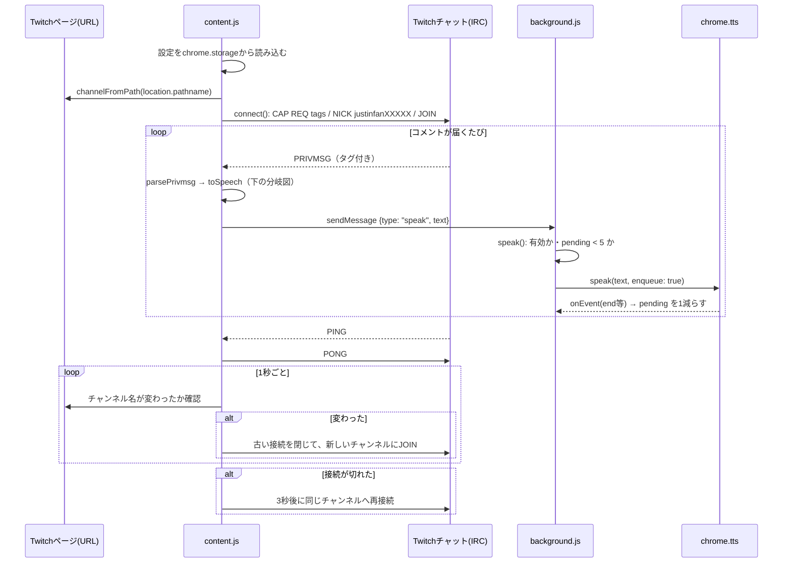
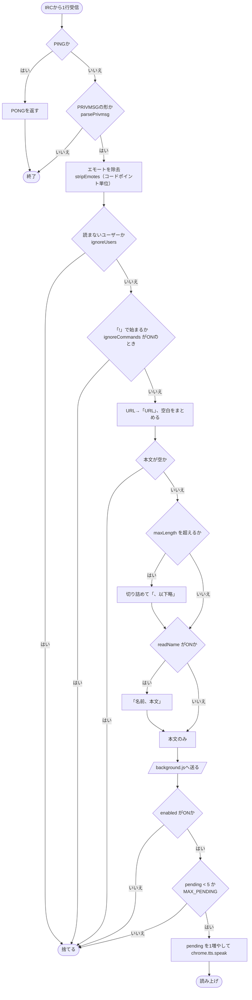

# ロジック

`content.js` が配信ページのURLからチャンネル名を取り出し、Twitchのチャットに匿名で参加してコメントを受け取る。コメントを1件ずつ整形・除外したうえで `background.js` に送り、`background.js` が待ち行列の上限を確かめてから `chrome.tts` で読み上げる。

## 接続から読み上げまでの時間順

- TwitchはSPAで、チャンネルを移ってもcontent scriptが再実行されないため、URLを1秒ごとに見て接続し直す
- 設定の変更は、`content.js` には `storage.onChanged` ですぐ反映される。`background.js` はコメントのたびに設定を読み直す

## コメント1件を読むか捨てるか

- A〜Kが `content.js`、「background.jsへ送る」から下が `background.js`
- エモート位置はTwitchがコードポイント単位で渡すため、UTF-16のindexで消すと絵文字を含む文でずれる
- 「読み上げを止める」ボタンは `chrome.tts.stop()` で待ち行列ごと消し、`pending` を0に戻す
