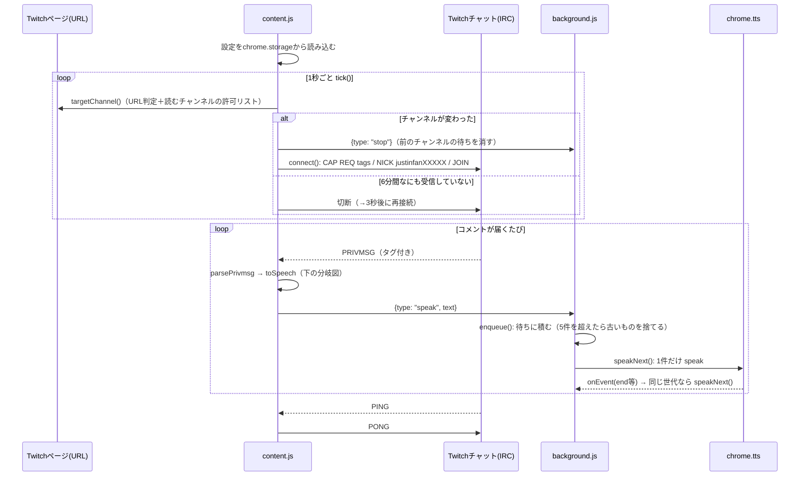
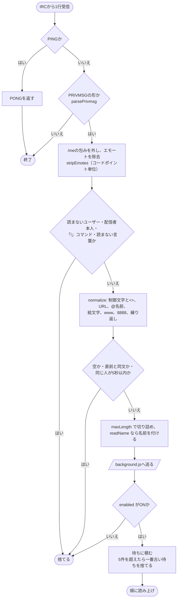

# ロジック

`content.js` が配信ページのURLからチャンネル名を取り出し、Twitchのチャットに匿名で参加してコメントを受け取る。コメントを1件ずつ整形・除外したうえで `background.js` に送り、`background.js` が自前の待ち行列から1件ずつ `chrome.tts` で読み上げる。

## 接続から読み上げまでの時間順

- TwitchはSPAで、チャンネルを移ってもcontent scriptが再実行されないため、URLを1秒ごとに見て接続し直す
- 停止（ショートカット・ボタン・OFF・チャンネル移動）は `generation` を1つ進める。止める前の発話の終了イベントは世代が合わないので無視し、次の発話を始めない
- 拡張を再読み込みすると、古いページからは `sendMessage` が例外になる。そのとき接続とURL監視を止める

## コメント1件を読むか捨てるか

- A〜Iが `content.js`、「background.jsへ送る」から下が `background.js`
- 1行の処理で例外が出ても、同じフレームの後続の行は処理を続ける
- エモート位置はTwitchがコードポイント単位で渡すため、UTF-16のindexで消すと絵文字を含む文でずれる
